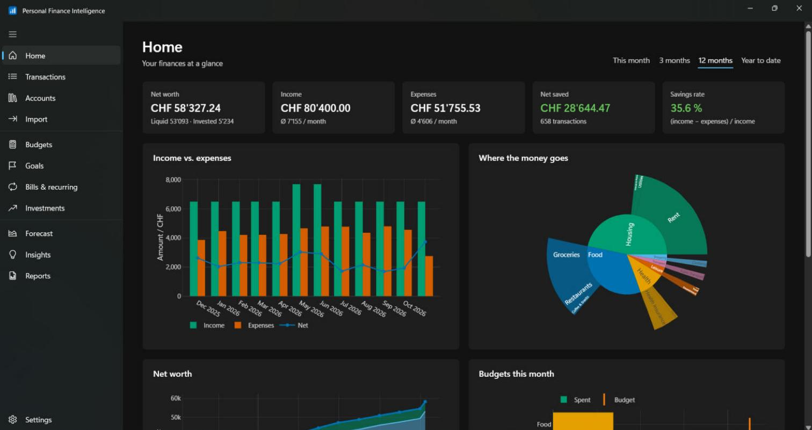
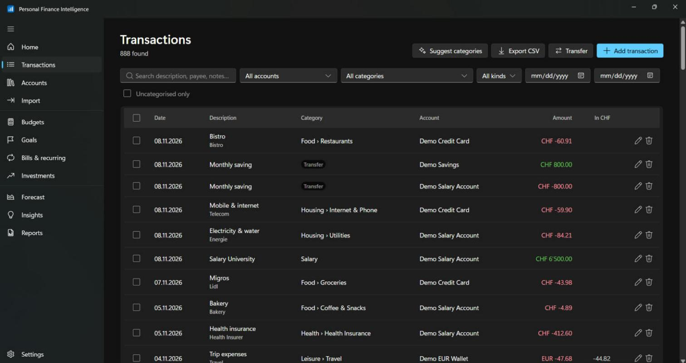
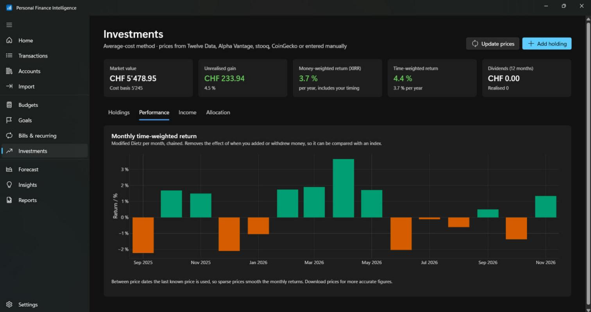
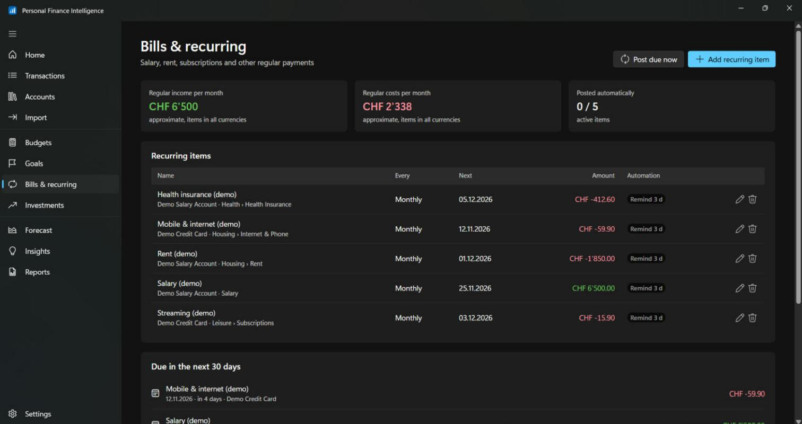
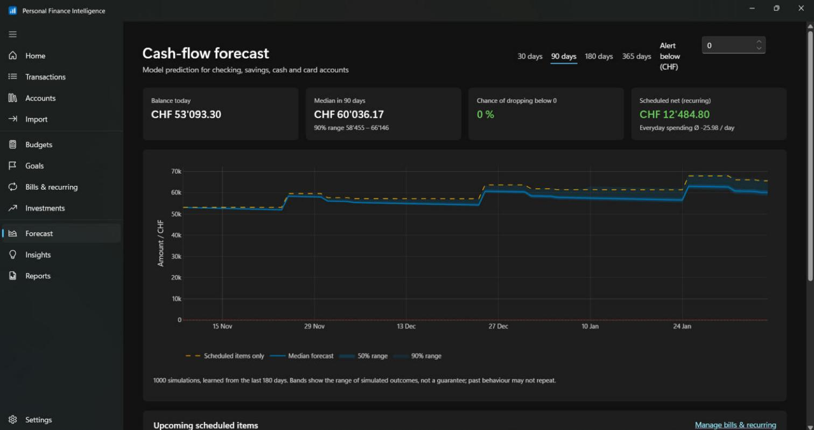
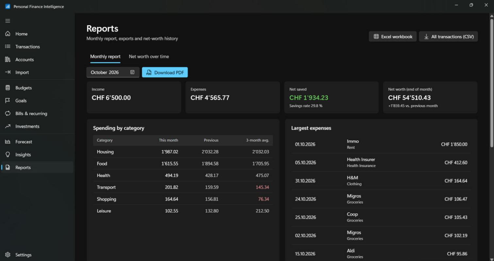

# Personal Finance Intelligence

A Windows 11 desktop app to track income, expenses, investments and savings
goals, forecast cash flow and analyse spending. Everything runs and stays on
your PC: the data lives in one local SQLite file, there is no account and no
cloud.

**English · Français · العربية**, base currency of your choice (CHF, EUR,
MAD, USD…) with accounts in any currency.

<a href="https://apps.microsoft.com/detail/9MZKW4H9F0J5?mode=direct">
  
</a>

Free on the Microsoft Store for Windows 10 (2004) and Windows 11, x64; or
build it yourself (see [Build](#build)).

## Screenshots

Shown with the built-in demo data (Settings → Load demo data).

| | |
|---|---|
|  |  |
| **Home:** net worth, income vs. expenses, where the money goes | **Transactions:** categories, filters, CSV export |
|  |  |
| **Investments:** money- (XIRR) and time-weighted returns | **Bills & recurring:** due dates and reminders |
|  |  |
| **Forecast:** Monte Carlo with 50 % and 90 % ranges | **Reports:** PDF, Excel and CSV |

## Features

- **Accounts & transactions:** checking, savings, cash, cards, investments,
  loans; transfers between accounts (also across currencies); import of
  CSV, Excel, OFX/QFX, QIF and CAMT.053 statements with column presets,
  side-by-side review of possible duplicates and undo; bulk edit (category,
  account, tags, delete) of many transactions at once.
- **Reconcile:** tick the transactions on your bank statement until the
  difference is zero; reconciled transactions are locked (and can be
  unlocked by undoing the latest reconciliation).
- **Smart categories:** your own rules first, then suggestions learned from
  the transactions you categorised yourself (naive Bayes, validated
  chronologically on your newest transactions against a "most common
  category" baseline; the accuracy is shown in Settings).
- **Bills & recurring:** salary, rent and subscriptions can post themselves on
  the due date, and Windows notifications remind you before they are due.
- **Budgets & goals:** monthly limits per category with projection; savings
  goals linked to accounts.
- **Debt payoff:** interest rate and minimum payment per loan or card;
  avalanche, snowball and minimum-only plans with payoff dates and total
  interest for any extra monthly amount.
- **Investments:** average-cost positions, end-of-day prices from Twelve Data
  (US listings) or Alpha Vantage (worldwide) with your free key, stooq,
  CoinGecko (crypto), or entered manually; money-weighted (XIRR) and
  time-weighted returns, dividend income, target allocation with drift.
- **Forecast:** recurring items plus a block-bootstrap Monte Carlo of your
  everyday spending, with percentile bands and the chance of going below a
  threshold.
- **Insights:** unusual expenses (robust z-score), detected subscriptions,
  category shifts.
- **Splits & tags:** split one payment across several categories (budgets
  and reports count each part); free tags such as "Holiday 2026" with a
  spending-by-tag report; photos or PDFs of receipts attached to
  transactions.
- **Spending calendar:** a heatmap of every day's spending and a year in
  review (savings rate, no-spend days, biggest expense, top categories,
  change against the year before).
- **Reports:** monthly PDF report, Excel workbook, CSV export, net-worth
  history.
- **Security & data:** optional app lock with Windows Hello; weekly automatic
  backups to a folder you choose (e.g. OneDrive), optionally encrypted with
  a password (AES-256); one-click "Move to another PC".
- **Look:** light, dark or the same as Windows, switchable in every page
  header.

## Architecture

| Layer | Technology | Folder |
|---|---|---|
| Desktop shell | WinUI 3 (C++/WinRT, Windows App SDK), NavigationView, Mica, WebView2, Windows Hello, app notifications | `desktop/` |
| Screens | Next.js 16 (static export), TypeScript, Fluent UI React v9, plotly.js | `frontend/` |
| API & analytics | Python 3.12, FastAPI, SQLAlchemy, pandas, numpy, Plotly, reportlab, openpyxl | `backend/` |
| Database | SQLite (`pfi.sqlite` in the data folder); money stored as exact integer cents | created at runtime |
| Packaging | PyInstaller, Inno Setup (`.exe` installer), MakeAppx (`.msix` for the Microsoft Store) | `scripts/`, `installer/`, `packaging/` |

The shell starts the backend (`pfi-api.exe`) in a Windows job object on a
free localhost port with a per-launch token, then shows the screens in
WebView2. The data folder is `%LOCALAPPDATA%\PersonalFinanceIntelligence`
(or the app's private storage when installed from the Store).

Up to 0.3 the app ran a private PostgreSQL server. Version 0.4 moved that
data into SQLite on its first start (and kept the old folder as
`pgdata-0.3`); since 0.5 PostgreSQL is no longer part of the app.
Settings › Old data from PFI 0.3 deletes what 0.4 left behind. Data from
0.3 that was never opened with 0.4 can still be moved with the
[0.4.0 installer](https://github.com/MrBlizo/personal-finance-intelligence/releases/tag/v0.4.0);
0.5 explains this instead of starting with an empty database.

## Build

Requirements: Windows 11, Visual Studio 2022/2026 with *Desktop development
with C++* and *WinUI application development* (includes a Windows SDK),
Miniconda, Node.js LTS and Inno Setup.

Double-click **`build.bat`**. It runs the backend tests, builds the screens,
packages the backend, builds `PFI.exe`, smoke-tests the packaged app and
creates:

- `dist\PFI-Setup-0.5.0.exe`: installer for direct download;
- `dist\PFI-0.5.0.0-x64.msix`: package for the Microsoft Store (fill in
  `packaging\store.json` with the identity from Partner Center first).

Progress: `dist\build.log`; result: `dist\build-status.txt`. Options:
`-SkipTests`, `-SkipInstaller`, `-SkipMsix`, `-DebugBuild`.

### Develop

```bat
:: backend (conda-forge environment)
cd backend
conda env create -f environment.yml
conda activate pfi
pytest -q
python run.py --port 8765          :: API docs at http://127.0.0.1:8765/docs

:: screens in a browser, against the backend above
cd frontend
npm ci
npm run dev                         :: http://localhost:3000
```

For the desktop shell, run `build.bat` once (or `scripts\restore-desktop.ps1`),
open `desktop\PFI.sln`, choose **Debug | x64** and press **F5**; the Debug
build runs the backend from source (`pfi.dev.ini`).

## Data and privacy

Your financial data never leaves your PC. The only network requests are
optional: daily exchange rates (only currency codes are sent) and market
prices for holdings you link to an online source (only the symbol is sent).
See [PRIVACY.md](PRIVACY.md).

## Contributing

Issues and pull requests are welcome; see [CONTRIBUTING.md](CONTRIBUTING.md).

## License

[MIT](LICENSE) © 2026 Ibrahim (MrBlizo)
