# Personal Finance

**The offline budget app for Windows, with an Android app that stays in
sync:** budgets, bank statement import, debt payoff plans and investments,
with no account and no Personal Finance server.
[Website and guides](https://mrblizo.github.io/personal-finance-intelligence/)

A Windows desktop app to track income, expenses, investments and savings
goals, forecast cash flow and analyse spending. Everything runs and stays on
your devices: the data lives in one local SQLite file, there is no account
and no Personal Finance server. The optional Android app syncs through a folder in your
own OneDrive, encrypted with your passphrase.

**English · Français · العربية**, base currency of your choice (USD, EUR,
GBP, CHF, MAD…) with accounts in any currency.

<a href="https://apps.microsoft.com/detail/9MZKW4H9F0J5?mode=direct">
  
</a>

Free on the Microsoft Store for Windows 10 (2004) and Windows 11, x64; or
build it yourself (see [Build](#build)).

**Android:** download `PFI-<version>.apk` from the
[latest release](https://github.com/MrBlizo/personal-finance-intelligence/releases/latest)
and allow installing it when Android asks. Then set up sync in Settings ›
Sync on the PC and on the phone, with the same OneDrive and passphrase.

## Screenshots

Shown with synthetic sample data (no real finances).

| | |
|---|---|
| 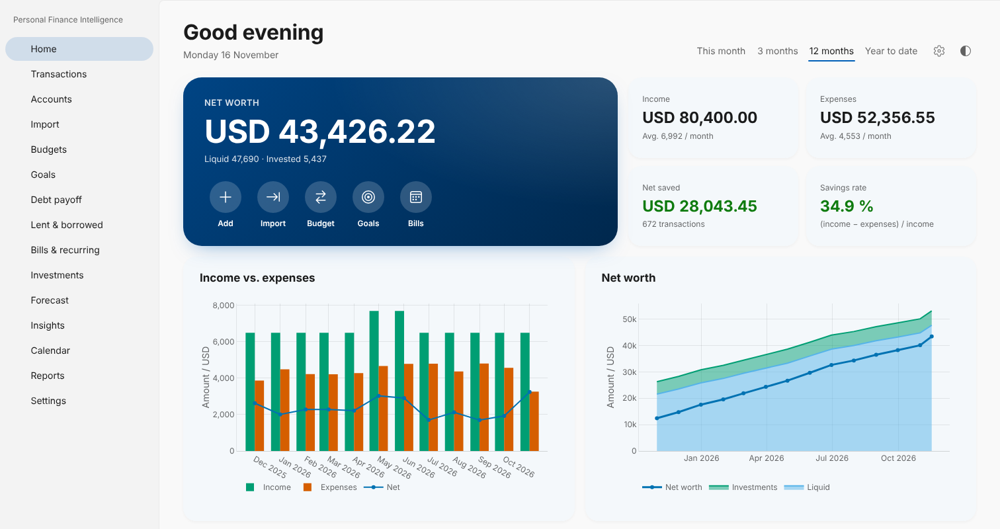 | 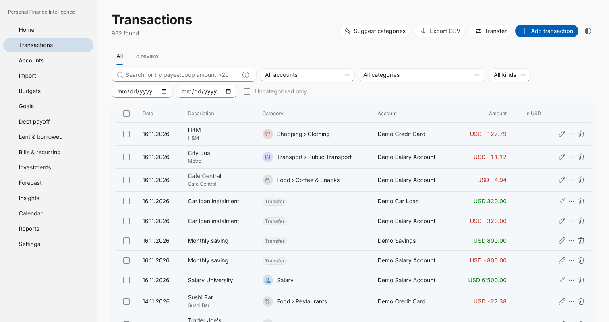 |
| **Home:** net worth with quick actions, income vs. expenses, net worth | **Transactions:** categories, filters, CSV export |
| 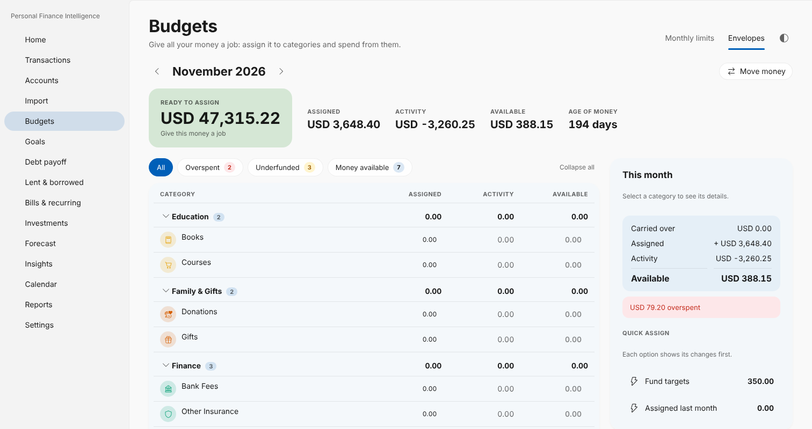 | 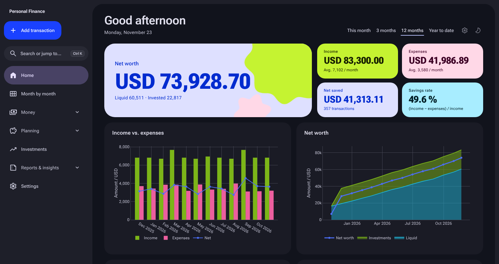 |
| **Budget:** envelopes with groups, filters, targets and quick assign | **Dark mode:** light, dark or follow Windows |
| 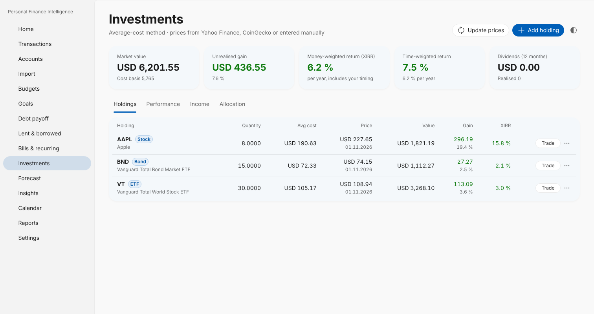 | 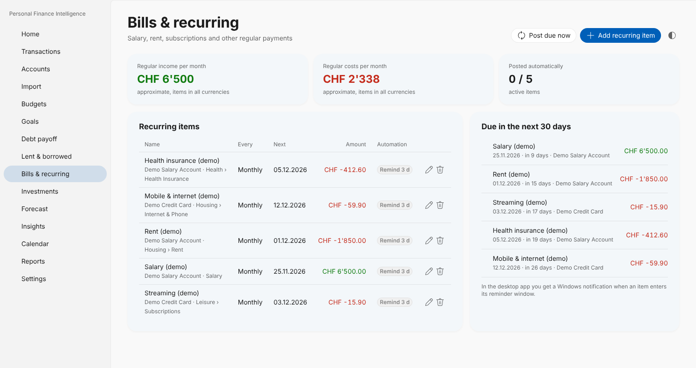 |
| **Investments:** money- (XIRR) and time-weighted returns | **Bills & recurring:** due dates and reminders |
| 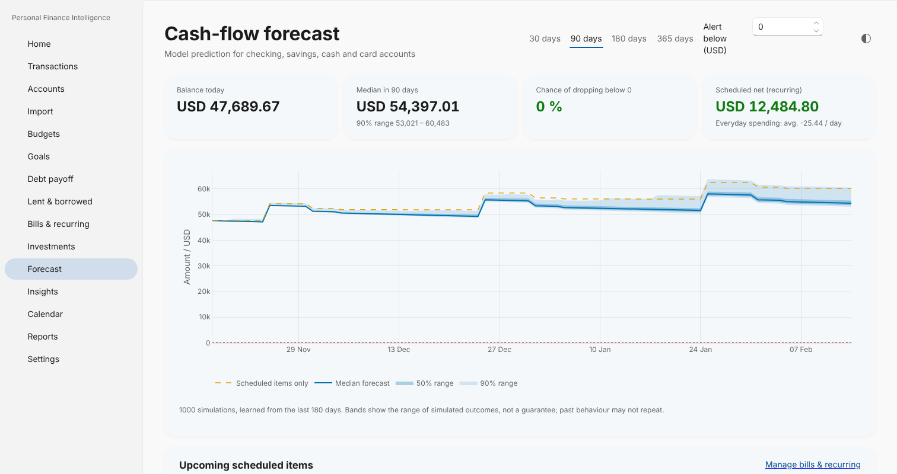 | 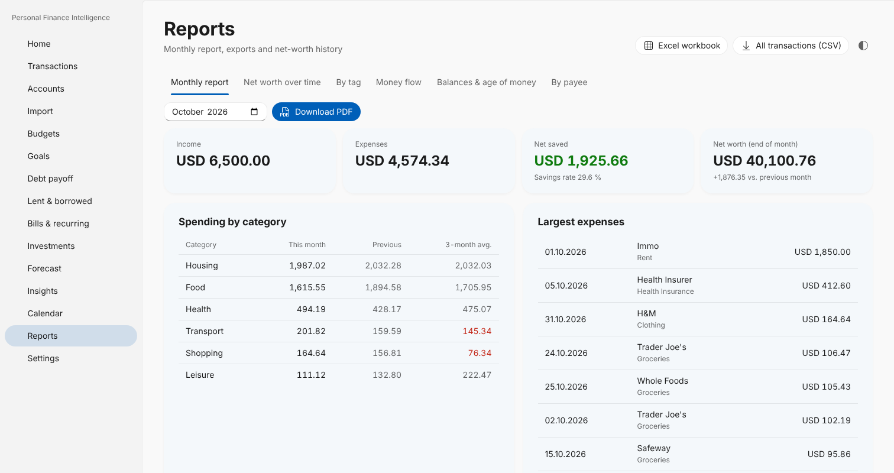 |
| **Forecast:** Monte Carlo with 50 % and 90 % ranges | **Reports:** PDF, Excel and CSV |
| 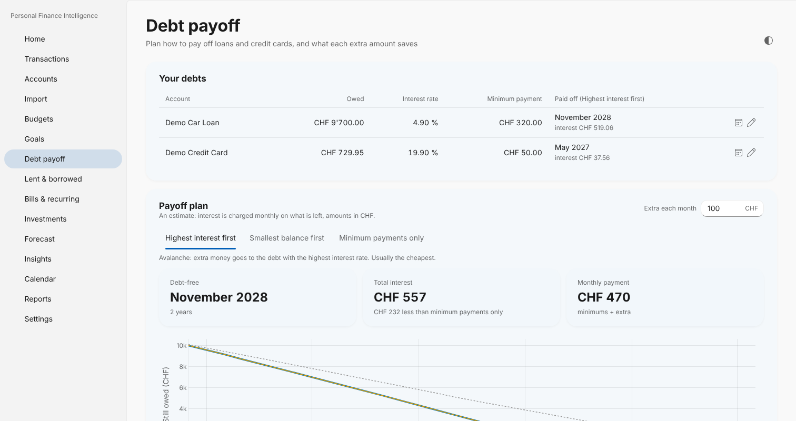 | 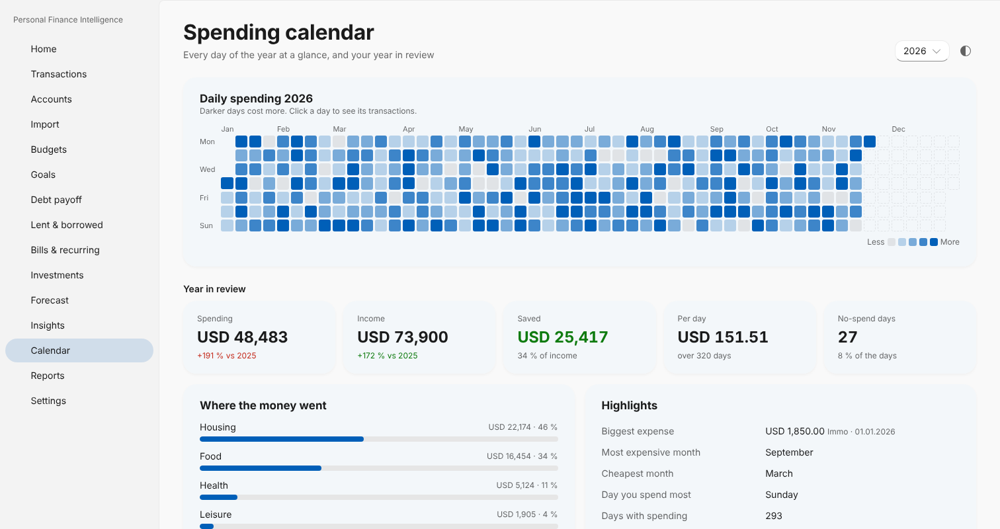 |
| **Debt payoff:** highest interest first, smallest balance first, minimums only | **Spending calendar:** daily heatmap and year in review |
| 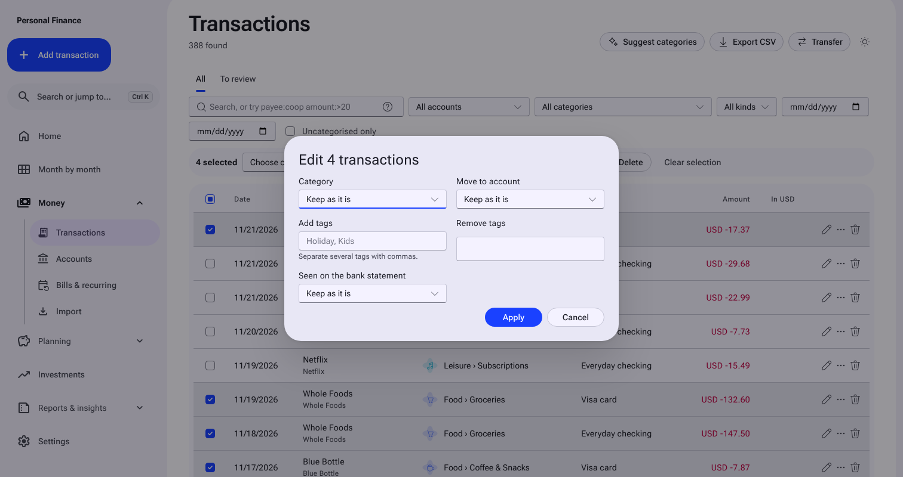 | |
| **Bulk edit:** category, account, tags or delete for many rows | |

## Features

- **Accounts & transactions:** checking, savings, cash, cards, investments,
  loans; transfers between accounts (also across currencies); import of
  CSV, OFX/QFX, QIF and CAMT.053 statements with column presets,
  side-by-side review of possible duplicates and undo; bulk edit (category,
  account, tags, delete) of many transactions at once. Quick add (Ctrl+N)
  remembers payees and accepts sums such as `12.50+3`; category, payee and
  amount can be edited directly in the list; search filters such as
  `payee:migros amount:>50 before:2026-06-01 is:unreviewed`; imported and
  automatic transactions wait in a review queue.
- **Reconcile:** tick the transactions on your bank statement until the
  difference is zero; reconciled transactions are locked (and can be
  unlocked by undoing the latest reconciliation).
- **Smart categories:** your own rules first, then suggestions learned from
  the transactions you categorised yourself (naive Bayes, validated
  chronologically on your newest transactions against a "most common
  category" baseline; the accuracy is shown in Settings).
- **Bills & recurring:** salary, rent and subscriptions can post themselves on
  the due date, and Windows notifications remind you before they are due.
- **Budgets & goals:** choose between monthly limits per category with
  projection, or envelope budgeting (give all your money a job, move money
  between categories, carry-over, monthly/weekly/yearly or by-date targets,
  quick assign); weekly, monthly, yearly or custom period budgets across
  several categories; savings goals linked to accounts.
- **Lent & borrowed:** money you lent to or borrowed from friends, with
  partial repayments and due dates.
- **Debt payoff:** interest rate and minimum payment per loan or card;
  avalanche, snowball and minimum-only plans with payoff dates and total
  interest for any extra monthly amount. Month-by-month schedule per loan, and the
  payment needed to be debt-free by a chosen date.
- **Investments:** average-cost positions, end-of-day prices from Yahoo
  Finance (stocks, ETFs and funds worldwide, no key), CoinGecko (crypto), or
  entered manually; money-weighted (XIRR) and
  time-weighted returns, dividend income, target allocation with drift.
- **Forecast:** recurring items plus a block-bootstrap Monte Carlo of your
  everyday spending, with percentile bands and the chance of going below a
  threshold.
- **Insights:** unusual expenses (robust z-score), detected subscriptions,
  category shifts.
- **Splits & tags:** split one payment across several categories (budgets
  and reports count each part); free tags such as "Holiday 2026" with a
  spending-by-tag report; photos or PDFs of receipts attached to
  transactions.
- **Spending calendar:** a heatmap of every day's spending and a year in
  review (savings rate, no-spend days, biggest expense, top categories,
  change against the year before).
- **Month by month (1.0):** what you earned, spent, paid (bills, card and
  loan payments) and saved each month, compared with the month before, with
  the spending pace and the biggest expenses. Also on the phone.
- **Receipt scanning (1.0):** drop a photo on Quick add and Windows' offline
  text recognition reads the total, date and shop; on the phone, ML Kit does
  the same on the device. Nothing is uploaded.
- **What if and financial independence (1.0):** try a purchase, a raise or a
  bill change against the forecast and get a plain verdict; estimate when
  your investments could pay for your spending.
- **Reports:** monthly and yearly PDF reports, a tax export (CSV) by the
  categories you mark, Excel workbook, CSV export, net-worth history,
  money-flow (Sankey) diagram, balance history per account, age of money and
  spending by payee.
- **Import from YNAB, Cashew and Mint:** reads their exports with a dry run
  first; YNAB also brings transfers, splits and budget assignments.
- **Trust (1.0):** a first-run setup assistant, Check my data, a review of
  items changed on two devices before they synced, a daily update check
  (not in the Store version), and upgrade tests on databases from every
  release since 0.4.
- **Security & data:** optional app lock with Windows Hello; weekly automatic
  backups to a folder you choose (e.g. OneDrive), optionally encrypted with
  a password (AES-256); move to a new PC through sync.
- **Phone app and sync (0.7):** the Personal Finance app for Android keeps the same data
  as the PC through a folder in your OneDrive, encrypted with your
  passphrase (no Personal Finance server). See [mobile/README.md](mobile/README.md) and
  [design/sync-protocol.md](design/sync-protocol.md).
- **Look:** Material 3 Expressive in Personal Finance violet, with a neon dark mode;
  light, dark or the same as Windows, switchable in every page header;
  eleven accent colours; icons and colours per category; a Home page whose
  cards you can reorder or hide; Ctrl+K to jump to any page or action.
- **Phone extras (1.0):** statement (CSV) import, bill reminders and
  over-budget alerts, and an update check for the APK (or use Obtainium).

## Architecture

| Layer | Technology | Folder |
|---|---|---|
| Desktop shell | WinUI 3 (C++/WinRT, Windows App SDK), NavigationView, Mica, WebView2, Windows Hello, app notifications | `desktop/` |
| Screens | Next.js 16 (static export), TypeScript, Fluent UI React v9, plotly.js | `frontend/` |
| API & analytics | Python 3.12, FastAPI, SQLAlchemy, pandas, numpy, Plotly, reportlab, openpyxl | `backend/` |
| Database | SQLite (`pfi.sqlite` in the data folder); money stored as exact integer cents | created at runtime |
| Packaging | PyInstaller, Inno Setup (`.exe` installer), MakeAppx (`.msix` for the Microsoft Store) | `scripts/`, `installer/`, `packaging/` |

The shell starts the backend (`pfi-api.exe`) in a Windows job object on a
free localhost port with a per-launch token, then shows the screens in
WebView2. The data folder is `%LOCALAPPDATA%\PersonalFinanceIntelligence`
(or the app's private storage when installed from the Store).

Up to 0.3 the app ran a private PostgreSQL server. Version 0.4 moved that
data into SQLite on its first start (and kept the old folder as
`pgdata-0.3`); since 0.5 PostgreSQL is no longer part of the app.
Settings › Old data from Personal Finance 0.3 deletes what 0.4 left behind. Data from
0.3 that was never opened with 0.4 can still be moved with the
[0.4.0 installer](https://github.com/MrBlizo/personal-finance-intelligence/releases/tag/v0.4.0);
0.5 explains this instead of starting with an empty database.

## Build

Requirements: Windows 11, Visual Studio 2022/2026 with *Desktop development
with C++* and *WinUI application development* (includes a Windows SDK),
Miniconda, Node.js LTS and Inno Setup.

Double-click **`build.bat`**. It runs the backend tests, builds the screens,
packages the backend, builds `PFI.exe`, smoke-tests the packaged app and
creates:

- `dist\PFI-Setup-1.0.0.exe`: installer for direct download;
- `dist\PFI-1.0.0.0-x64.msix`: package for the Microsoft Store (fill in
  `packaging\store.json` with the identity from Partner Center first).

Progress: `dist\build.log`; result: `dist\build-status.txt`. Options:
`-SkipTests`, `-SkipInstaller`, `-SkipMsix`, `-DebugBuild`.

### Develop

```bat
:: backend (conda-forge environment)
cd backend
conda env create -f environment.yml
conda activate pfi
pytest -q
python run.py --port 8765          :: API docs at http://127.0.0.1:8765/docs

:: screens in a browser, against the backend above
cd frontend
npm ci
npm run dev                         :: http://localhost:3000
```

For the desktop shell, run `build.bat` once (or `scripts\restore-desktop.ps1`),
open `desktop\PFI.sln`, choose **Debug | x64** and press **F5**; the Debug
build runs the backend from source (`pfi.dev.ini`).

## Data and privacy

Your financial data never leaves your PC. The only network requests are
optional: daily exchange rates (only currency codes are sent) and market
prices for holdings you link to an online source (only the symbol is sent).
See [PRIVACY.md](PRIVACY.md).

## Feedback

Bug reports and ideas are welcome as
[issues](https://github.com/MrBlizo/personal-finance-intelligence/issues).
Code contributions are not accepted for now; see
[CONTRIBUTING.md](CONTRIBUTING.md).

## License

Free to use, not free to take. From 1.0.0, Personal Finance is released under the
[PolyForm Strict License 1.0.0](LICENSE) © 2026 Ibrahim Oulkhir (MrBlizo).

- You may download Personal Finance and use it for free, for personal and other
  noncommercial purposes, and read its source code.
- You may not sell it, redistribute it, or publish changed versions or apps
  built from its code.
- For any other use (for example inside a company), ask first by opening an
  issue.

The code stays visible so anyone can check what Personal Finance does with their data.
Earlier releases keep the licences they were published under: up to 0.7.0
under MIT, and 0.7.1 to 0.9.0 under the GNU AGPL-3.0. Those copies remain
available under those terms.
